<p align="center">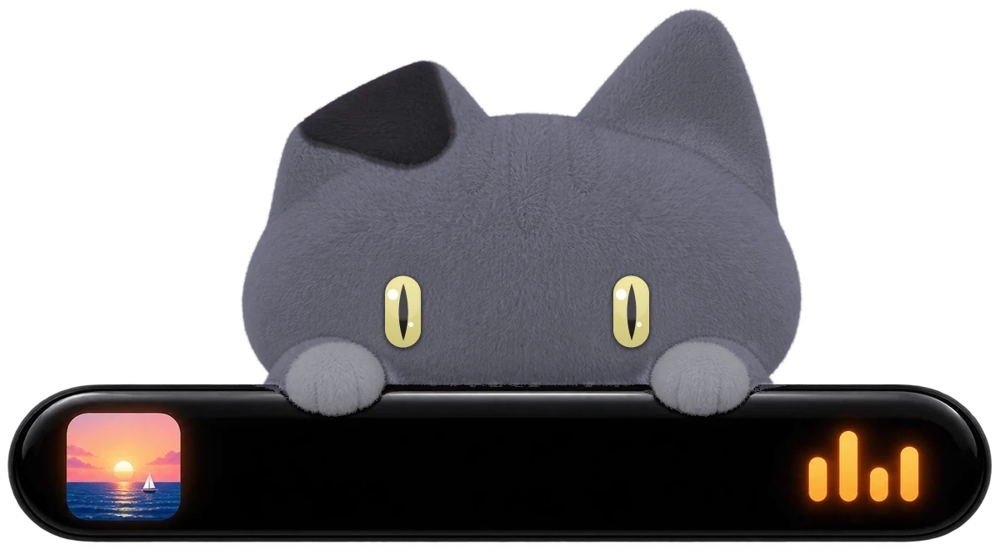</p>

<h1 align="center">Halo Island</h1>

<h3 align="center">A living notch for Windows</h3>

<p align="center">Like the Dynamic Island on a phone, for your computer. A small island hangs from the top of your screen, shows what's playing, counting down and arriving, and opens into quick pages when you point at it.</p>

<p align="center">
  <a href="https://github.com/kolijijani/halo-island/releases/latest/download/Halo-Island-Setup.exe"></a>
</p>

<p align="center">
  <a href="https://kolijijani.github.io/halo-island/"><b>Website</b></a>
  &nbsp;·&nbsp;
  <a href="#features">Features</a>
  &nbsp;·&nbsp;
  <a href="#install">Install</a>
  &nbsp;·&nbsp;
  <a href="#faq">FAQ</a>
  &nbsp;·&nbsp;
  <a href="#guides">Guides</a>
</p>

<p align="center">
  <a href="https://github.com/kolijijani/halo-island/releases/latest"></a>
  <a href="https://github.com/kolijijani/halo-island/blob/metrics/README.md"></a>
  <a href="LICENSE"></a>
  
</p>

<p align="center">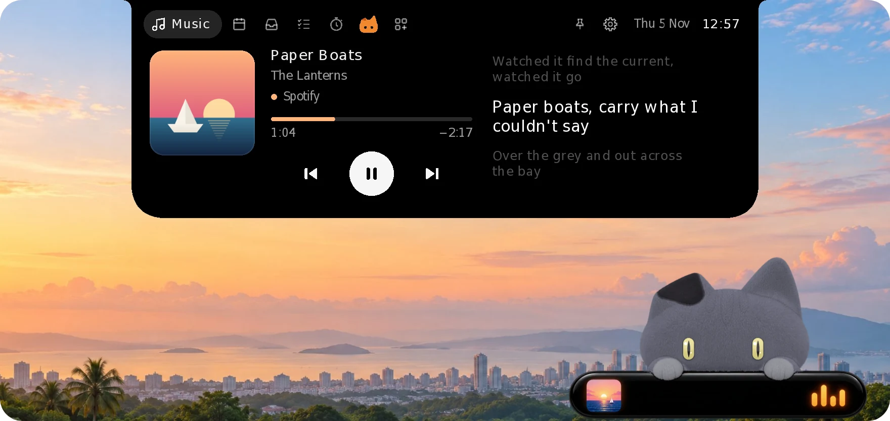</p>

<p align="center"><sub>Free and open source &nbsp;·&nbsp; Windows 10 and 11 &nbsp;·&nbsp; No account needed</sub></p>


## Features

### Music, word by word

Controls for whatever is playing: Spotify, Apple Music, YouTube in your browser, or any app in Windows' media controls. The lyrics scroll in time with the song, and Korean, Japanese and Chinese lines get their reading underneath, the way Apple Music shows pronunciation. The line being sung also shows on the closed island, in every theme, with its reading in Latin letters under it, so you can sing along without opening it. Drag the bar to jump anywhere in a song.

<p align="center">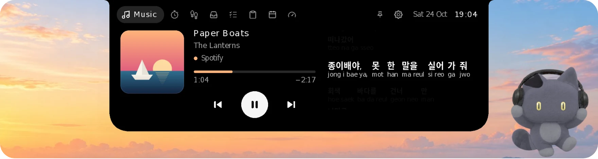</p>

Lyrics come free from [LRCLIB](https://lrclib.net), or from Apple Music itself with [your Apple Music token](#apple-music-lyrics).

### What's happening, at a glance

While it rests, the island is a small black pill that tells you what's going on, then gets out of the way: album art, the line being sung and a beat while music plays, your focus timer, volume and charging, headphones connecting with their battery, Caps Lock on or off, joining or leaving a Wi-Fi network, the next prayer.

On Windows, pop-ups take turns: one at a time, a newer word about the same thing (Caps Lock off right after on) replaces the older one instead of queueing, and at most three wait. With Windows' animation effects off (Accessibility › Visual effects) they come and go without the morph. They never take the keyboard from the app you're in. Each can be switched off under **Settings › Pop-ups**. What Windows lets them see:

- **Caps Lock:** read from the keyboard's raw input, the Caps Lock key alone; no other key is looked at or kept. The state starts from Windows' word when the pop-up is switched on and flips with each press, so a Caps Lock changed by another program (not the key) isn't seen.
- **Wi-Fi:** Windows' own network-change event, no polling. The network's name shows only where Windows gives it to apps (on Windows 11, with location allowed for desktop apps); otherwise it says "Wi-Fi". Connected to Wi-Fi is not the same as online: a network without internet says so. Ethernet and VPN changes don't pop up.
- **Bluetooth:** as before, headphones, earbuds and speakers that are paired, with their name and battery where Windows reports them.
- Not offered, as Windows has no reliable signal for them an app may read: Num Lock and Scroll Lock (rare on laptops), the microphone's mute key (vendor-specific), and screen brightness keys (only some laptops report them).

<p align="center">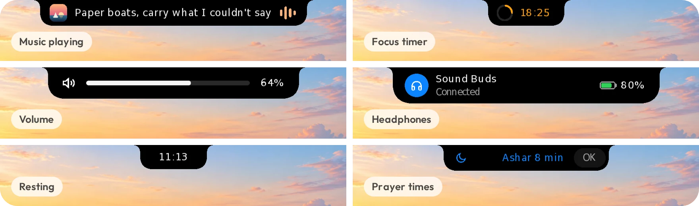</p>

### From your phone to your PC, no app needed

Open the Shelf, scan the code with your phone's camera, pick photos or files and tap **Send**. The island asks first, then they land on the Shelf. It works with iPhones and Android phones over your own Wi-Fi, and a phone you pair once can send from any network.

<p align="center">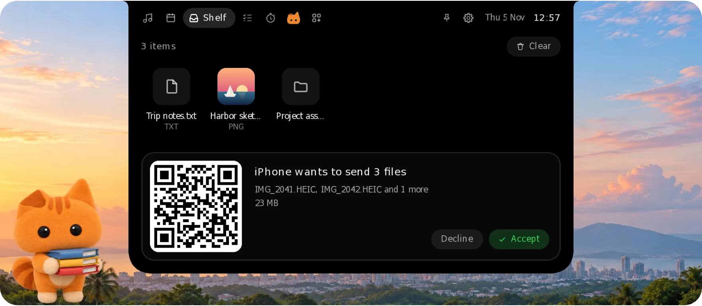</p>

[How Phone drop works](#phone-drop) &nbsp;·&nbsp; [Paired phones](#paired-phones-send-from-any-network)

### FPS, GPU and CPU over your games

Switch on **Show over games** and, while a borderless full-screen game is in front, the island becomes a small readout: frames per second, the GPU's load and temperature and the CPU's load. It reads Windows' own log of each frame, the way PresentMon and Xbox Game Bar count them, so nothing is loaded into the game.

<p align="center">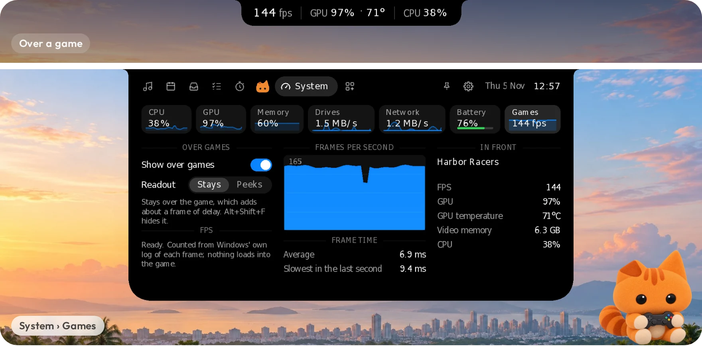</p>

[More on Show over games](#show-over-games)

### Your whole computer on one page

CPU, GPU, memory, drives, network and battery: rings and gauges, each core's load, the last minute of history and the apps using the most. Read straight from Windows' own counters, with no drivers and no admin rights, and it never leaves your PC. **System** is an [add-on](#add-ons): its tab shows once you switch it on, and until then nothing reads the counters.

On a desktop, **Power** shows what the whole PC draws: split into the CPU, the graphics card and the rest. A Corsair HXi or RMi, or an MSI MEG Ai or MPG Ai…TS power supply reports the real number over its USB cable, with what it pulls from the wall, its efficiency and its temperature; Halo Island only reads it, while the page is open. With any other power supply, the page estimates: the CPU's own reading, the graphics card's (NVIDIA cards report theirs through the driver), and about 40 W for the board, memory, drives and fans.

<p align="center">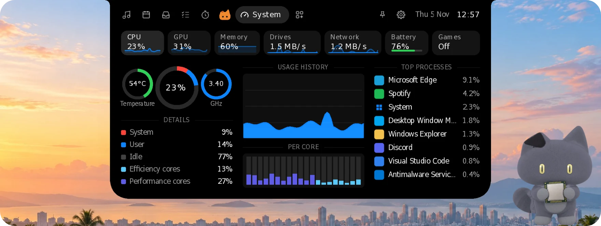</p>

### The small things, one hover away

**Focus** is a Pomodoro timer that keeps counting in the island. **Tasks** is a tiny to-do list. **Today** has the date and this month, beside [the top stories of the day](#news-on-today). **Shelf** keeps the files you drop on the island. The tabs run Music, Widgets, Today, Shelf, Tasks, Focus and AI; System, Stocks and the rest are [add-ons](#add-ons). Scroll over the top of the island to switch pages. Don't need one of the first five? Switch it off under **Tabs** in Settings and it leaves the row.

<p align="center">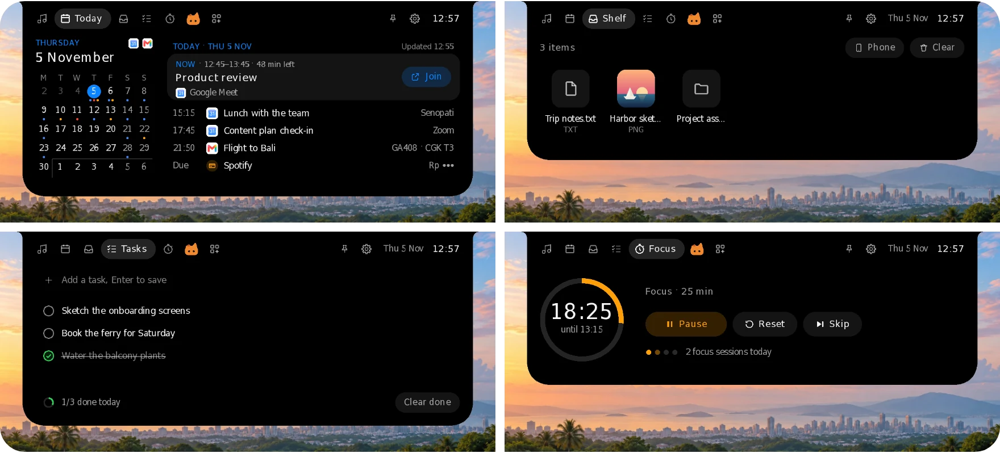</p>

### Your AI plans, before you run out

**Part of Studio Pro.** The **AI** tab, right after Focus, shows what's left of the AI coding plans on your computer: Codex, Claude Code, OpenCode Go and more. Each one gets a card with your plan, each limit as a bar with when it resets, and credits or balance left. Switch on **Tell me before I run out** and the island tells you when a limit is nearly used up, and when it's back. Each sign-in is read on your computer and goes only to its own service; nothing about your usage goes to Halo.

[What it reads, service by service](docs/ai-usage.md)

### Black, Halo, Glass, Pill or Diorama

The island is black by default, like the one on a phone. **Halo** turns it warm cream, and Halo the cat moves in: he peeks over the edge, follows your pointer and sleeps from midnight to five. **Glass** bends and frosts whatever is behind it, after Apple's Liquid Glass. **Pill** changes the shape: the island floats just below the top of the screen as a black capsule, with the time and battery at rest, the song and the line being sung while music plays, and a rounded card when it opens. **Diorama** is Pill with a picture in its resting capsule: a small window onto a pixel-art place, a house, a tree and a sky that follows your clock from dawn to night.

<p align="center">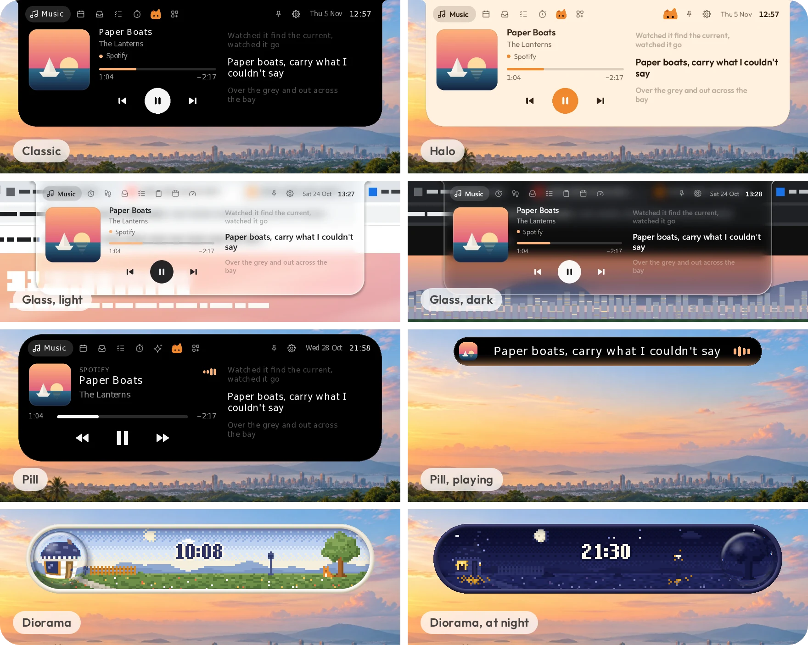</p>

[The Halo theme](#the-halo-theme) &nbsp;·&nbsp; [The Glass theme](#the-glass-theme) &nbsp;·&nbsp; [The Pill theme](#the-pill-theme) &nbsp;·&nbsp; [The Diorama theme](#the-diorama-theme)

### News on Today

**Today** shows the top stories of one news source you pick under **Settings › General › News on Today**: BBC World (the default), CNA, Al Jazeera or Bernama, each their own public feed, no account. Each story is its headline, its source and how long ago, and one key point: the first sentence of its summary, never written by Halo Island. Only stories from the last day and a half count, at most four, in the order the source's editors put them. A click opens the story in your browser.

It reads the feed only while Today is open: as it opens, when the last read is over 15 minutes old. Without internet it says so; when the feed times out, can't be reached, answers with an error or sends something that isn't a feed, it says which, keeps the stories it had with their age, and tries again after 30 seconds, then a minute and longer, up to 10 minutes, only while Today stays open. Another feed: put its RSS or Atom address in `news_feed` in settings.json.

### Prayer times for your city

Today's times for your kab/kota as Kemenag RI publishes them, or for your city anywhere else in the world, a countdown in the ten minutes before each prayer, the adzan, and the qibla. It's an add-on: under 1 MB, downloaded only when you switch it on.

<p align="center">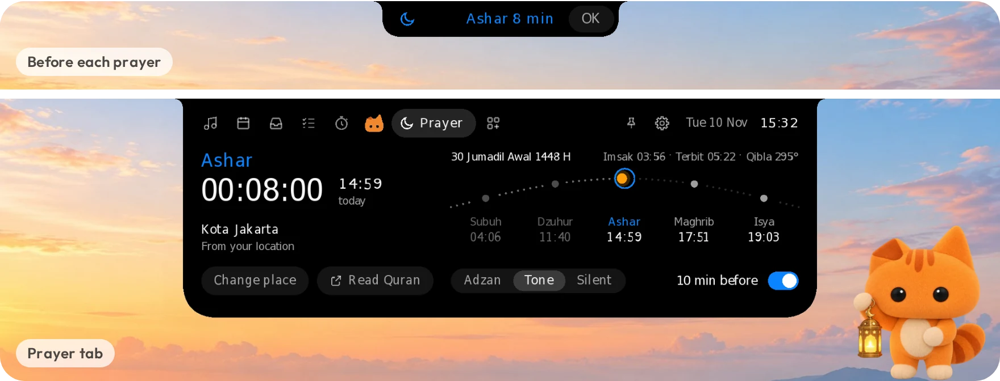</p>

[Add-ons](#add-ons)

## Light by design

<table>
<tr>
<td align="center" width="25%"><h3>2.4 MB</h3>download on Windows</td>
<td align="center" width="25%"><h3>Rust</h3>native code, no web view, no runtime</td>
<td align="center" width="25%"><h3>60–240 Hz</h3>drawn on the GPU, in step with your screen</td>
<td align="center" width="25%"><h3>0</h3>accounts, ads or analytics</td>
</tr>
</table>

On Windows it draws on your graphics card in step with your display's refresh rate (60, 144 or 240 Hz), and draws nothing while nothing moves. Features you don't use don't run: Show over games counts only while a game is in front, and add-ons download only when you switch them on. With the System add-on on, its page keeps its last minute of history with a light reading once a second. It rests while your PC is locked, the screen is off or battery saver is on, and starts a fresh minute when you're back; right-click › **Keep System page history** turns it off.

## Your data stays on your computer

- **No account, no tracking.** Tasks, the Shelf, focus history and the drinks you add to Caffeine are files in your own user folder. There are no ads and no analytics.
- **Your files stay yours.** Phone drop asks before it takes anything and uses your own Wi-Fi. Files from paired phones are encrypted with keys made on the two devices, and the meeting server never sees them.
- **Little goes online.** Lyrics lookups go to LRCLIB while a song plays, and a couple of minutes after start (at most once a day once it gets through) the app reads one small file to see whether a new version is out. Apple Music lyrics, Halo, paired phones and add-ons connect only after you turn them on, and the AI tab asks your AI services only while it's open or its notices are on. [PRIVACY.md](PRIVACY.md) lists every request.

## Install


### Windows

**[Download Halo-Island-Setup.exe](https://github.com/kolijijani/halo-island/releases/latest/download/Halo-Island-Setup.exe)** and run it. It installs just for you and needs no admin rights. Older versions and a portable zip are on the [Releases](https://github.com/kolijijani/halo-island/releases) page.

Builds aren't code-signed yet, so Windows SmartScreen may say "Windows protected your PC". Click **More info → Run anyway**.

Your data lives in `%APPDATA%\Halo\`, and cache plus log in `%LOCALAPPDATA%\Halo\`. Uninstalling removes the app, cache and log, and keeps your data.

## FAQ

<details>
<summary><b>Is it free?</b></summary>
<br>

Yes. Halo Island is free to download and use, and its code is open source under the [MIT license](LICENSE). Halo sign-in is optional.

</details>

<details>
<summary><b>Will it slow my computer down?</b></summary>
<br>

It's built not to. It's native code with no web view, it draws nothing while nothing moves, and its features sleep until you use them. See [Light by design](#light-by-design).

</details>

<details>
<summary><b>Why does Windows say "Windows protected your PC"?</b></summary>
<br>

The Windows builds aren't code-signed yet, so Windows SmartScreen doesn't know them. Click **More info → Run anyway**.

</details>

<details>
<summary><b>Does it work on Windows 10?</b></summary>
<br>

Yes, on Windows 10 and 11. Glass needs Windows 10 version 2004 or later to bend what's behind it; before that it draws smoked glass.

</details>

<details>
<summary><b>Can it hide during games and videos?</b></summary>
<br>

Yes: right-click the island › **In full-screen apps** › **Hide**. Pick **Stay on top** instead to keep it over borderless games and videos, or turn on [Show over games](#show-over-games) for a frame rate readout.

</details>

<details>
<summary><b>Does it cover my browser tabs?</b></summary>
<br>

It sits over the middle of the top edge, so over a maximized browser it can cover the tabs there. You can move it: press the closed island and drag it left or right along the top edge. It stays where you leave it, also after a restart, and opens away from the screen's edge. To put it back, drag it to the middle (it snaps there) or right-click it › **Move island to the centre**. To keep the top edge clear while nothing plays, right-click the island › **Idle look** › **Hidden until hover**: only an invisible strip stays at the top edge until you point at it.

</details>

<details>
<summary><b>Where are my files and settings?</b></summary>
<br>

In `%APPDATA%\Halo\` (cache and log in `%LOCALAPPDATA%\Halo\`). Uninstalling keeps your data.

</details>

## Guides

The details behind each feature.

### Settings and options

The gear at the top right of the open island opens **Settings**: your Halo account first, then the theme, the idle look and the switches below, and last **Advanced settings**. That opens a window with every setting in one place, and the island closes as it opens: General (start with Windows, sounds, the 24-hour clock, the version with **Check now**), Appearance (the theme and the idle look), Island (how soon it opens and closes, its width, the display, full-screen apps and games), Music and lyrics, Pop-ups (volume, charger and battery, Bluetooth), Tabs, Add-ons, Focus, Prayer times, AI usage, your Halo account and About. It follows Windows' light or dark mode. Right-click the island or the tray icon for the quick ones, and **Advanced settings…** opens the window too:
- the theme: Classic, Halo, Glass, Pill or Diorama
- the idle look: clock, eyes (Halo in his theme), minimal, hidden until you hover, or a status bar (in Pill; the other themes show the clock); Diorama has the clock, minimal and hidden
- lyrics (and the pronunciation line under Japanese, Korean and Chinese lyrics) and sounds
- in full-screen apps: hide, or stay on top of borderless games and videos (a game in exclusive full-screen mode still covers it), and show FPS, GPU and CPU over games
- start with Windows, which version you have (**About Halo Island**, with the build's day; it opens that version's release notes), and quit
- in Settings only: which version you have, with **Check now** ([New versions](#new-versions)); in Advanced settings, everything the menu doesn't have

### The Halo theme

The island stays black by default. Switch on the Halo theme (the gear › **Theme › Halo**, or right-click › **Theme › Halo**) and the whole island becomes Halo's: warm cream with dark brown text, his orange on the play button, the bars and the switches, and Outfit, the Halo Island typeface. Halo, the Halo cat, moves in too: he peeks over the island's edge while it rests, watches your pointer when it comes near, sits beside the clock, peeks up beside the pin when the island is open and bobs along while music plays. He sleeps from midnight to five. He is drawn from the Halo logo, not a picture, so he stays sharp at any scaling, and he only moves for a moment now and then, so he costs no CPU at rest.


### The Glass theme

Glass turns the island into liquid glass, after Apple's Liquid Glass. Its rim bends and magnifies what's under it, the middle is frosted, a light runs along the edge, and the shadow under it deepens over busy pages. The collapsed island turns light or dark with what's behind it, and the open island follows Windows' light or dark mode. Its tint goes only as deep as the text needs to stay readable (4.5:1).

To bend what's under it, Glass copies the part of the screen behind its window (the island and the space it opens into) whenever something there changes, and not while the island is hidden, a full-screen app is in front (there it draws smoked glass, so a game's frames aren't copied) or the PC is locked. The copy stays in your PC's memory and on its graphics card, and each new copy replaces the last; it's never saved or sent. While Glass is on, Windows leaves Halo Island out of screenshots, screen recordings and screen sharing. On a display in HDR, Halo Island maps the copy back to ordinary colours itself. Where it can't copy the screen (the software renderer, Windows 10 before version 2004, Remote Desktop, a laptop display that no graphics card lets it copy), Glass draws smoked glass instead: the same shape, light and shadow over a see-through tint, and it stays in screenshots.

### The Pill theme

Pill changes the island's shape and layouts, not only its colours. Pick it with right-click › **Theme › Pill**, or the gear › **Theme › Pill**.

- **It floats.** The island sits a little below the top edge: a capsule while it rests, and a card with all four corners rounded when it opens. A soft shadow and a fine rim keep it apart from the wallpaper, light or dark.
- **At rest** it shows the time and, on a laptop, the battery's percentage and the battery on the right, with a bolt while it's plugged in. A desktop shows the time alone. Pick **Idle look › Status bar** and it widens into a status bar: the volume, the date and time in an inner pill, and the battery. Status bar is Pill's own; the other themes keep the clock.
- **While music plays** it shows the album art, the line being sung (or the title and artist between lines) and bars in the album's colour, with a glow of it along the bottom edge.
- **Open**, it's a card with Classic's tabs. The Music page lays out like a player card: the art, the player's name over the song, the time on one line and big controls, with the lyrics beside them. Pop-ups, notices and the focus timer take the capsule shape too.
- **Colour only where it means something:** the album's colour for music, green for a charging battery, red for a low one, and your Windows accent elsewhere.

The pages and features are the same as in Classic.

### The Diorama theme

Diorama is Pill with a picture in its resting capsule: a long, small window onto a pixel-art place that keeps the hours of your day. Pick it with right-click › **Theme › Diorama**, or the gear › **Theme › Diorama**.

- **The place.** Behind a raised frame, cream by day and indigo at night, stand a house at one end and a tree at the other, with a letter box, a garden fence and a lamp post between them and hills behind. The lamp is lit from dusk through the night.
- **It follows your clock.** Dawn is pink, the day is blue with the sun crossing the sky and clouds drifting by, the light turns golden from about an hour before sunset, and after dusk the stars come out one by one under the moon in tonight's phase. The window is lit until midnight and again from five, with smoke from the chimney while breakfast and supper cook.
- **The cat's day.** A grey cat sits by the door at dawn, walks out to the tree, naps under it around noon, comes home for the golden hour and sits in the lit window after dark. From midnight to five it's nowhere to be seen.
- **The glass ball.** A glass ball that magnifies what's under it rests on the house by day and on the tree at night. At sunset it rolls across and night falls behind it; at sunrise it rolls back. It rolls once when you pick the theme, too.
- **Slide it.** Press the glass ball and slide it along: the place runs on through the day with it, through the golden hour and the sunset into the night (or at night through the small hours into the morning). Let go and it rolls on to the end it was nearer, or the one you threw it toward; tap it to send it to the other end. Left on the other side of the day, the whole theme keeps that side until the clock comes round to it: by day, 45 minutes after sunset; at night, 50 minutes after sunrise. Pressing the ball never opens or moves the island; press anywhere else on it for that.
- **The time** is written in the sky between the house and the tree, 12- or 24-hour as you've set it. On a laptop, a bolt stands beside it while the battery charges, and a red battery at 20% or less. Pick **Idle look › Minimal** for the place without the clock.
- **Your own sunrise and sunset.** With the [Prayer times](#add-ons) add-on on and a place picked, the sun rises and sets when it does there. Otherwise it rises at six and sets at six.
- **The whole island matches.** The open card, the music pill, timers, pop-ups and notices are the same raised frame round a pane: cream with slate ink by day, indigo with cream ink and the window's gold at night, in the Outfit typeface. They change with the ball.
- **What it costs:** the picture is painted once a minute, with the tick the clock already wakes for, and nothing runs in between. The ball's roll draws frames for about a second and a half; a slide draws one each time the pointer moves.

Everything else works as in Pill: music, timers, pop-ups, notices and the open card, with the same pages and sizes.

### Show over games

Switch on **Show over games** (System › Games, or right-click › In full-screen apps) and, while a game fills the screen in borderless full-screen, the island becomes a small readout: frames per second, the GPU's load and temperature and the CPU's load. It stays for as long as the game is in front; **Alt+Shift+F** hides it until the next game, and pressing it again brings it back. Any window over a borderless game, the island included, makes Windows combine the two before they reach the screen, which costs the game about a frame of delay. If you'd rather not pay it, pick **Readout › Peeks** in System › Games (or right-click › In full-screen apps › Only for a few seconds): the readout then shows for a few seconds when the game comes to the front, when the frame rate drops sharply and whenever you press Alt+Shift+F, then hides, and in between the game's frames go straight to the screen. Turning it on also lets the island show over full-screen apps; picking Hide there turns it off again. Alt+Shift+F belongs to Halo Island only while a game is in front.

The frame rate is counted the way Intel's PresentMon and Xbox Game Bar count it: Windows logs every frame a game hands to the screen, and Halo Island reads that log for the game in front. Nothing is loaded into the game, so there is nothing for anti-cheat to see. DirectX 9 to 12 games are counted from their own Present calls; Vulkan and OpenGL games from the graphics kernel's log of their frames. The GPU and CPU numbers come from the same readers as the System page. Nothing runs while no game is in front or while the readout is off.

Windows lets only admins and the **Performance Log Users** group read that log. The first time, System › Games asks for a one-time OK: an admin prompt adds your Windows account to that group (Xbox Game Bar's FPS counter asks for the same), and Windows applies it the next time you sign in. Until then the FPS slot shows a dash and the rest works. To undo it, remove your account from Performance Log Users in Computer Management, or run `net localgroup "Performance Log Users" <your user name> /delete` as an admin. A game in exclusive full-screen mode still covers the island, as it covers every window.

### Apple Music lyrics

Lyrics come from LRCLIB by default. With an Apple Music subscription, Halo Island can show Apple Music's own synced lyrics instead: the ones the Apple Music app shows. This works whichever app is playing. LRCLIB stays the backup for songs Apple has no synced lyrics for.

It needs your Apple Music token, copied once from the web player:

1. Open [music.apple.com](https://music.apple.com) in Chrome or Edge and sign in.
2. Press F12, open **Application** → **Cookies** → `https://music.apple.com`, and copy the value of `media-user-token`.
3. Right-click the island (or the tray icon) → **Apple Music lyrics** → **Use token from clipboard**.

Halo Island checks the token with Apple and says whether it worked. It stores the token encrypted for your Windows account (`%LOCALAPPDATA%\Halo\apple-music-token.bin`) and clears it from the clipboard. If Windows clipboard history (Win+V) is on, delete it there too. A token lasts for months; when Apple stops accepting it, Halo Island says so and you copy a fresh one. **Remove token** in the same menu turns this off.

With a token saved, Halo Island sends each song's title and artist to Apple to find its lyrics. It uses the Apple Music web player's own API, which Apple doesn't publish for other apps, so it can stop working when Apple changes its site. LRCLIB keeps working either way.

### Phone drop

Send photos and files from your phone to the Shelf, or save Shelf files on your phone, over your own Wi-Fi. Nothing to install on the phone, and it works with iPhones and Android phones alike.

1. Open the Shelf and click **Phone** (on an empty shelf, the **Phone drop** tile). A QR code opens under the shelf.
2. Scan it with the phone's camera. The phone opens a small page that Halo Island serves from your PC.
3. Pick photos or files on the phone and tap **Send**. The island asks first: **Accept** or **Decline**. Accepted files go to `Downloads\Halo Island` and onto the Shelf.
4. The page also lists the files on the Shelf. Tap **Save** to keep one on the phone.

| | |
|---|---|
| 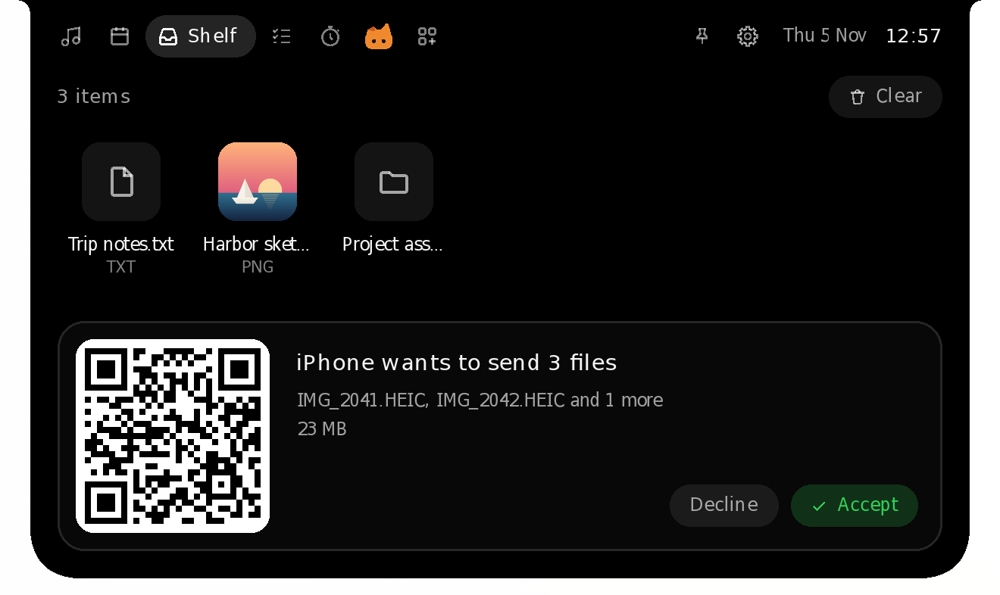 | 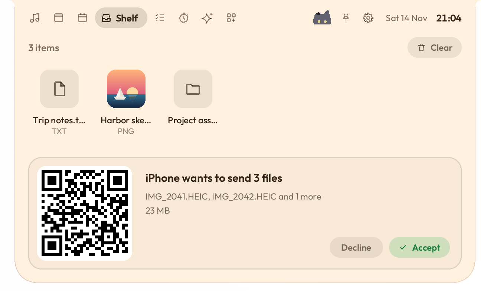 |

The phone and the PC need the same Wi-Fi; guest networks often keep devices apart. The first time, Windows asks whether Halo Island may use the network: allow it on private networks. If Windows treats your Wi-Fi as a public network, set it to private (Settings > Network & internet > Wi-Fi), or the phone can't reach the PC.

Each session gets a new secret link that only the QR code carries. It stops working when you click **Done**, and after 10 minutes without a phone. Halo Island reads nothing from an upload before you accept, keeps a transfer only when every file arrived, and never sends anything through the internet. Files travel over your Wi-Fi without extra encryption on top of the Wi-Fi's own, so use Phone drop on networks you trust rather than public hotspots.

This isn't AirDrop. An iPhone only AirDrops over Apple's own Wi-Fi link (AWDL), which Windows Wi-Fi drivers can't run, so Phone drop uses the phone's browser instead.

#### Paired phones: send from any network

Pair a phone once, and it finds this PC from any network, whenever Halo Island runs: the same Wi-Fi, another Wi-Fi or mobile data.

1. In the phone panel, click **Pair a phone** and scan the new code. The phone opens `drop.halo.com` and says it's paired.
2. Keep that page: on an iPhone, tap Share › **Add to Home Screen**; on Android, install it (Chrome or Samsung Internet). Android then lists **Halo Island** in the share sheet.
3. Send from the share sheet or from the page. Files from your own paired phones go straight onto the Shelf, with a notice on the island.

| | |
|---|---|
| 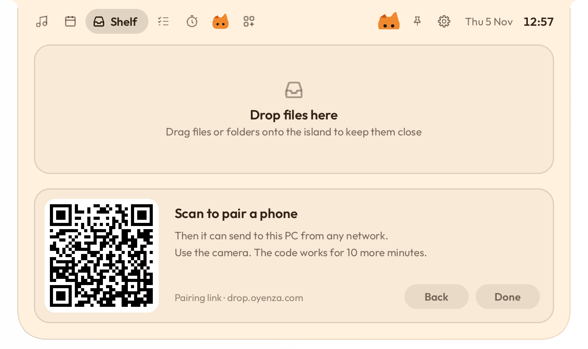 | 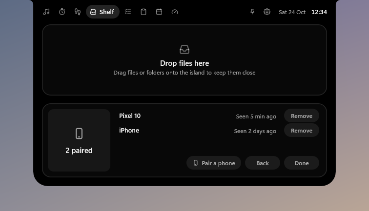 |


The phone and PC meet through a small server (`drop.halo.com`, code in [`server/`](server)); the files go straight between them over WebRTC, encrypted with keys made on the two devices, or through a relay that can't read them when both networks block a direct link. The server never sees a file, a file name, or the pairing secret: every message is signed with that secret, which only the QR code carries. **Paired phones** lists each phone with **Remove**. How it works: [docs/paired-drop.md](docs/paired-drop.md).

### Halo (optional)

Signing in to [Halo](https://halo.app) is optional and works like a TV: no password is typed into Halo Island. It tells the island whether your account has Studio Pro.

1. Open the island, press the gear at the top right, and choose **Sign in with Halo** (right-click the island or the tray icon → **Halo** → **Sign in to Halo…** works too). The island shows an 8-letter code.
2. Open halo.app/connect on your phone or this computer (**Open halo.app** fills the code in), check the computer's name, and choose **Connect**.

This PC gets a key of its own that can do only these things: it reads nothing about your money (no transactions, balances, bills, account numbers, notes or receipts), and it can't change or delete anything or touch your account. The key is stored encrypted for your Windows account (`%LOCALAPPDATA%\Halo\halo-link.bin`). Halo Island asks Halo only whether your account has Studio Pro, when a page that needs it opens. **Disconnect** in Settings (or **Halo › Disconnect** in the menu) signs this PC out; you can also disconnect it in halo.app under Connected apps.

### New versions

Halo Island looks for a new version a couple of minutes after it starts, by reading one small signed file from kolijijani.github.io/halo-island. If that look fails, it tries again every 30 minutes until one gets through, and it makes at most one successful look a day. It doesn't look while your PC is locked, the screen is off or battery saver is on. **Check for updates…** in the menu looks right away and says on the island what it found; **Check now** in Settings does the same and answers there. When there is a new version, the island says **Update available** with the version and keeps saying it until you click it or **Hide** it. The new version is already downloaded by then, and checked: click the notice for the Update sheet, then **Install now** (Halo Island closes, updates and opens again in a few seconds, your settings and data stay) or **Install on next start**. Until you update, the right-click menu starts with **Update to Halo Island x…** and Settings has a last row with **Update**. After you update, the island says **Updated to x** once, with **What's new**. How the file is made and signed: [docs/updates.md](docs/updates.md).

### Notifications

In the Microsoft Store copy, other apps' notifications show on the island: a WhatsApp or Telegram message, or your phone's through Phone Link, shows who it's from and the message for 8 seconds, and **Open** (or a click on it) opens the app. It's on from the start, with a **Notifications** tab: every app that has sent a notification since, each with a switch (WhatsApp, Telegram and Phone Link start on, the rest off), and **Who it's from** and **Message text** switches (off, they wait for **Show**). Nothing is read until you press **Allow** on the tab and say yes to Windows' question, and you can take it back in Windows Settings > Privacy & security > Notifications. Windows lets only an app installed as a package read notifications, so the download from GitHub has no Notifications. Nothing is sent anywhere or written down: Windows keeps its own list, as always. In Telegram Desktop, turn on Settings > Notifications and Sounds > Use Windows notifications. To switch it off, tap **Notifications** beside **Tabs** in Settings (or under **Tabs** in **Advanced settings**): there's no tab then, and nothing listens.

### Add-ons

The **+** at the end of the tabs lists features that stay off until you switch them on. Most aren't part of the download: switching one on downloads its files from this project's releases, or from this repository's own copy at a fixed public commit while a release isn't published (each checked against the size and SHA-256 built into the app either way), and switching it off deletes them. Its row says what's happening: no internet, the server timing out or down (both try again by themselves), a file that isn't available, or a file that came back wrong (never kept). While every add-on is off, nothing is downloaded and nothing of theirs runs.

**Prayer times** (959 KB) shows today's times for your kab/kota as Kemenag RI publishes them, with Imsak and Terbit, the next prayer and how long until it, and the qibla. Makkah, Madinah and Jeddah use Umm al-Qura. Outside Indonesia, any of 33,000 cities (every one of 15,000 people or more, looked up online as you type, so the add-on doesn't carry them) gets the times of the method its country follows, named beside the place: the Moonsighting Committee in the UK, the US and Canada, Umm al-Qura on the Arabian Peninsula, Dubai, Qatar, Kuwait, Singapore's for Singapore, Malaysia and Brunei, Diyanet in Turkey, Tehran in Iran, Karachi in South Asia (Hanafi Ashar there and in Central Asia), the Egyptian authority in Africa, Syria and Lebanon, and the Muslim World League everywhere else, on the city's own clock, summer time included. In the 10 minutes before each prayer the island counts down, and at the time it says so with a short tone, an adzan, or nothing. The adzan has two voices: Aaqib Azeez, or the Maghrib adzan at Masjid al-Haram in Makkah (1.8 MB, downloaded only when you pick it), and Subuh plays its own adzan with "as-salatu khairum min an-naum" (2.4 MB, with either voice). The play button beside the choice lets you hear it first. Music pauses for the adzan; **Stop** ends it. **OK** on the countdown puts it away until that prayer's time, and the song and its sung line come back.

- **Your place:** Windows' location picks the nearest of Kemenag's 517 places or of the world's cities, and checks again every few hours, so a trip moves the place. Away from Kemenag's places, the cities of the 5-degree squares around you come from this repository's city files (`site/places/1/`, at a fixed public commit); the point itself is used on your computer and never saved or sent. Only the place picked is saved, with its clock, so its times need nothing online. With location off, the computer's time zone suggests a place; **Change place** lets you type yours: a kab/kota, or any city.
- **Accuracy:** replayed against Kemenag's published 2026 schedule for all 517 places, 98.2% of 227,367 times match to the minute and none is more than a minute off. Outside Indonesia the times are [Adhan](https://github.com/batoulapps/adhan-js)'s own, checked to the minute against adhan-js on 47 cities over two years; near the poles, on days without a sunrise, a sunset or room for Ashar, they come from the nearest latitude that has them (`cargo test -p halo-core prayer`; details in [addons/sholat](addons/sholat/README.md)).

**Japanese readings** (3.8 MB) gives romaji under the kanji in Japanese lyrics on PCs where Windows can't read them (Windows keeps its Japanese reading data in the Japanese typing feature, which most PCs outside Japan don't have). Only people who play Japanese songs get it: the first time a song's kanji go unread, it switches itself on and downloads once, and the romaji show a moment later. Switch it off in Add-ons and it stays off; the Music page then offers it under the lyrics, one click away. Kana, Korean and Chinese read without it. Details in [addons/ja](addons/ja/README.md).

**System** (built in, nothing to download) adds the **System** tab: [your whole computer on one page](#your-whole-computer-on-one-page). It is off until you switch it on. Switched off, there's no tab and nothing reads the counters at rest; Show over games keeps its own switch.

**Stocks** (built in, nothing to download) adds a **Stocks** tab, laid out like Apple's Stocks app: Bursa Malaysia's FTSE KLCI and up to 10 stocks, each with its day's line against the previous close, its price and a change pill (click any pill to switch them all between percent and points). The one you pick fills the right side: its chart over 1D, 1M, 6M or 1Y (point at the chart to read any moment), and the day's high and low, previous close, volume, 52-week high and low, currency and exchange. **Add a stock** finds Bursa's biggest companies by name, short name or number (Maybank, 1155) at once, and any stock, fund or index in the world by its name or symbol (Apple, AAPL, 7203.T) from Yahoo Finance's search once you stop typing; **Edit** removes and reorders them. Prices come from Yahoo Finance (no key; `HALO_STOCKS_URL` points a test build elsewhere), as current as Yahoo has them, and are asked for only while the tab is open: every minute while a market on your list trades, every 10 minutes while all are shut. Without internet the tab says so; Yahoo asking it to slow down says "market closed or limited"; a timeout, an error or an answer that isn't prices says that instead, keeps the last prices with their time and tries again with a growing wait. No price is ever made up. Switched off, there's no tab and nothing is asked.

**Caffeine** (built in, nothing to download) adds a **Caffeine** tab: how much caffeine is still in you, hour by hour, from 06:00 to 06:00. Add what you drink: an espresso drink (Americano, Latte, Cappuccino and the rest) by how many shots and the beans (Arabica, Blend, Robusta or Decaf), the others by the cup, spoon, sachet, bottle or can, or **Your own** with a name and its mg. Coffee chains in Indonesia don't publish how many shots go into a drink, so that number is yours to enter. A drink's time starts at now: change it before you add it, or later by dragging its dot. **Last call** is the latest time today your usual drink can go in and leave at most 35 mg in you at bedtime, after a 2023 review of 24 studies of caffeine and sleep, and the island reminds you 30 minutes before it. The page warns past 400 mg in a day. Set your bedtime and your half-life in its settings, or switch the reminder off. The numbers are averages, not a reading of your body: what each one is, and where it comes from, is in [docs/caffeine.md](docs/caffeine.md). Your drinks stay on your computer, two weeks of them, and nothing is sent anywhere. Switched off, there's no tab and no reminder.

**IELTS** (built in, nothing to download) adds an **IELTS** tab: Halo becomes your IELTS Speaking examiner, GoPrep-style. Sign in to Halo, pick a level (1 to 5; each opens once you reach the target band on the level before it) and how Halo talks to you in Indonesian (**Sopan**, **Gaul** or **Ngegas**), and press **Mulai**. He asks Part 1 to 3 out loud, in English; tap the mic to answer and tap again when you're done (it stops by itself at the question's time). Part 2 gives you its card and a minute to prepare, then records by itself. At the end: your band, Fluency & Coherence, Lexical Resource, Grammar and Pronunciation with his notes, a roast and three tips. Music pauses while he talks or you answer and plays again after. Your answers go to Halo's server to be heard (see [PRIVACY.md](PRIVACY.md)); switched off, there's no tab, no microphone and nothing asked. IELTS® is a trademark of the IELTS partners; this isn't official IELTS material and isn't endorsed by them.

**Meeting notes** (built in, nothing to download; Windows) adds a **Notes** tab: one click and Halo listens to your meeting, then writes it up. Sign in to Halo and press the record button under him. He hears your microphone and your PC's own sound together, so a call in Google Meet, Zoom, Teams or WhatsApp is heard with no bot joining it, and a meeting in the room through the microphone; his head moves with the voices, a bar for each shows they're coming through, and the closed island shows him listening with the time. Press **Stop** when it's over: the meeting goes to Halo's server, Halo writes for a minute or two (you can close the island; a notice says when the notes are ready), and the notes are saved to Documents › Halo Island › Notes as a Markdown file: a title, a summary, the decisions, the action items with who and when, the topics, and the whole transcript with who said what. **Open notes**, **Copy** (the notes without the transcript, ready to paste into a chat or a doc) and the folder are on the page. Meetings up to 3 hours are written up. If something goes wrong, the recording stays on your PC for **Try again** until you throw it away. Let the people in the meeting know you're taking notes. Your meeting goes to Halo's server to be written up (see [PRIVACY.md](PRIVACY.md)); switched off, there's no tab, no recording and nothing sent.

**Script reader** (built in, nothing to download) adds a **Script** tab: a teleprompter right under your webcam. Paste a script or drop a `.txt` file on the island and press **Read**. The line to say stays bright with the next ones dim below, moving a line at a time at 60 to 300 words a minute. Space pauses, the arrow keys step a line or change the pace, and on Windows **Alt+Shift+S** pauses or resumes from any app. On Windows the island stays out of screen shares and recordings while the page shows. Switched off, there's no tab, no shortcut and nothing running.

**Screen recorder** (built in, nothing to download) adds a **Record** tab once [Halo Island Recorder](https://kolijijani.github.io/halo-island/) is installed: the island becomes the recorder's face, so the recorder shows no floating bar of its own. Pick **Screen** (the screen the island is on), **Window** or **Area** (the recorder's overlay asks for the window or the area), switch the **Camera**, **Mic** and **Sound** on or off, and press **Record**. While it records, the closed island shows the red dot and the time ahead of everything else; open it for **Pause** and **Stop**, which saves the video and opens the recorder's editor. The island stays out of the video. It switches itself on with the recorder (switch it off in Add-ons to get the recorder's own bar back) and is Windows-only for now.

## Build

Halo Island is a Cargo workspace:

| Crate | What |
|---|---|
| `crates/halo-core` | Pure logic (springs, lyrics parsing, Pomodoro, tasks, settings…), Phone drop's small web server and paired phone drop (pairing, signed messages, the WebRTC link). Unit-tested on any OS. |
| `crates/studio-usage` | The AI tab's readers: how much of each AI coding plan is left, from the computer and each service's own server. Unit-tested on any OS. |
| `crates/studio-diorama` | The Diorama theme's picture: its pixel-art place at any minute of the day, painted in plain Rust with no dependencies. Unit-tested on any OS. |
| `server` | The meeting server and phone page for paired phones (`drop.halo.com`); Node, no dependencies. |
| `crates/halo` | The app. On Windows: Win32 + Direct2D + WinRT through [windows-rs](https://github.com/microsoft/windows-rs). |

On Windows, with Rust stable and the MSVC toolchain:

```
cargo test -p halo-core -p studio-usage -p studio-diorama
cargo build -p halo --release        # target\release\halo.exe
```

To cross-build from macOS or Linux, install `mingw-w64` and add the target (`rustup target add x86_64-pc-windows-gnu`):

```
cargo wcheck                          # type-check the Windows app
cargo wbuild                          # target/x86_64-pc-windows-gnu/release/halo.exe
NSIS_HOST=user@linux-box tools/package.sh   # exe + portable zip + installer into dist/
```

### Testing without clicking around

`halo.exe --selftest <dir>` runs a scripted tour of every state with fake data and writes a screenshot of each one, plus `report.json` with layout and timing checks. The exit code is non-zero on failure. On a software rasterizer, such as GitHub's runners, a slow frame is listed in `slow_frames` instead of failing the run, and a scene gets 8 s instead of 3 to settle. It also works under Wine on Linux (`tools/run-selftest-wine.sh`), which is how the pictures in this README were made, so the font is a stand-in for Segoe UI.

| Variable | Effect |
|---|---|
| `HALO_SELFTEST_DPI=144` | Render at 150% scaling (also 120 and 192) |
| `HALO_SELFTEST_ANIM=1` | Also record the transitions frame by frame (plus each frame's screen position in `anim-<name>.json`) |
| `HALO_RENDERER=software` | Draw in software instead of on the GPU (also outside the self-test, for troubleshooting) |

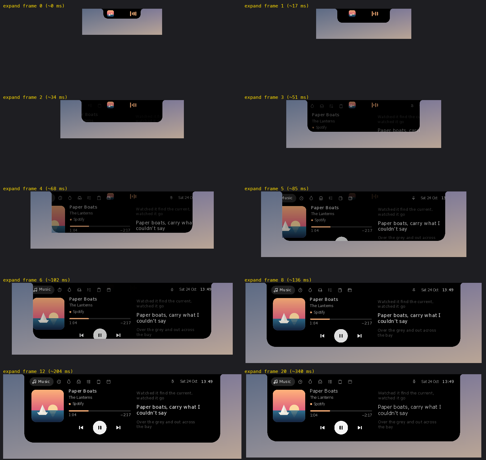

See [ARCHITECTURE.md](ARCHITECTURE.md) for how the pieces fit: threads, the rendering model, the page and service contracts, and data files.

### Website

The website is `site/index.html`, published with GitHub Pages by `.github/workflows/pages.yml` whenever `site/` or `docs/brand/` changes on main. Every release updates it too ([AGENTS.md](AGENTS.md#every-release-updates-the-website) has the checklist). A page that names a version not released yet waits until that release is published, and a release whose page wasn't updated opens an issue. Preview it with `tools/build_site.sh && python3 -m http.server -d _site 8000`. Its island screenshots come from the self-test at 200 % (Classic and Halo, plus Pill and Diorama for their own sections; `tools/site_shots.py`).

The README's feature pictures are drawn from those same screenshots by `tools/make_readme_art.py` (from `tools/readme_art.html`) into `docs/brand/readme/halo/`. Rerun it after retaking the screenshots.

### Download stats

[The stats page](https://github.com/kolijijani/halo-island/blob/metrics/README.md) shows downloads per release and per day. Every hour `.github/workflows/metrics.yml` reads GitHub's download counters with `tools/download_metrics.py` and keeps the history on the `metrics` branch. Downloads made by our own CI (the install test fetches the installer on every push) are left out. The app itself counts nothing.

## Status

Early, but in daily use on Windows 11. Most rough edges are in places a test machine can't fully exercise: specific media players, Bluetooth devices, and multi-monitor setups. Issues and pull requests are welcome. Please attach `%LOCALAPPDATA%\Halo\halo.log` when something misbehaves.

## Credits

- Synced lyrics come from [LRCLIB](https://lrclib.net), a free and open lyrics database. Halo Island fetches them only while a song plays and caches them on your PC.
- With your token, lyrics can also come from [Apple Music](https://music.apple.com) (see [Apple Music lyrics](#apple-music-lyrics)).
- Phone drop follows the design of [Windfall](https://github.com/UvejsGj/Windfall)'s phone page (MIT). QR codes come from [qrcodegen](https://github.com/nayuki/QR-Code-generator) (MIT).
- Romaji under Japanese lyrics comes from Windows' own reading analyzer or, on PCs without Windows' Japanese data, from [mecab-ipadic](https://taku910.github.io/mecab/) read with [vibrato](https://github.com/daac-tools/vibrato) (MIT/Apache-2.0).
- Paired phones follow the idea of [PairDrop](https://github.com/schlagmichdoch/PairDrop)'s paired devices (no code taken). The WebRTC link is [str0m](https://github.com/algesten/str0m) (MIT or Apache-2.0).
- Prayer times use the sun's position and calculation methods from [Adhan](https://github.com/batoulapps/adhan-js) (MIT), Kemenag RI's rules, and reference points fitted to Kemenag's published schedule. Cities outside Indonesia come from [GeoNames](https://www.geonames.org) ([CC BY 4.0](https://creativecommons.org/licenses/by/4.0/)), their time zones from the IANA time zone database. The adzan is "The Adhan - Muslim Call to Prayer - Aaqib Azeez" by Atcovi, from [Wikimedia Commons](https://commons.wikimedia.org/wiki/File:The_Adhan_-_Muslim_Call_to_Prayer_-_Aaqib_Azeez.mp3), [CC BY-SA 4.0](https://creativecommons.org/licenses/by-sa/4.0/) (mono, rumble filtered out, levelled; the add-on's copy is CC BY-SA 4.0 too).
- The AI tab's readers port logic from [CodexBar](https://github.com/steipete/CodexBar) by Peter Steinberger (MIT), and follow the services' own open-source tools for file names and requests (no code taken).
- Built with [windows-rs](https://github.com/microsoft/windows-rs) and [serde](https://serde.rs).

## License

The code is [MIT](LICENSE). The Halo Island name, its logo and the Halo character (the files in `docs/brand`, `installer/art` and the app icon) are not covered by the MIT license, so please don't reuse them in other projects. The Japanese reading dictionary (`crates/halo-core/data/ja-readings.dic.zst`, the Japanese readings add-on) is derived from mecab-ipadic and keeps its own license, which the add-on's `NOTICE.txt` carries. [THIRD-PARTY-NOTICES.txt](THIRD-PARTY-NOTICES.txt), which ships with every download, holds that license and those of the Unicode data and the Rust crates Halo Island is built from.
